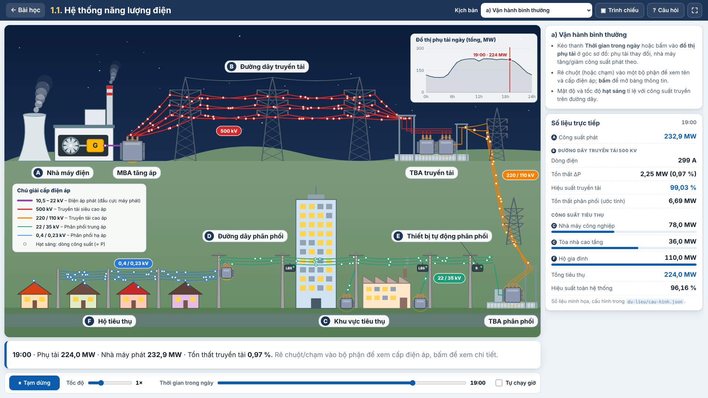
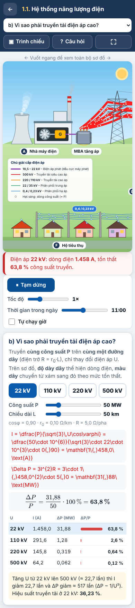
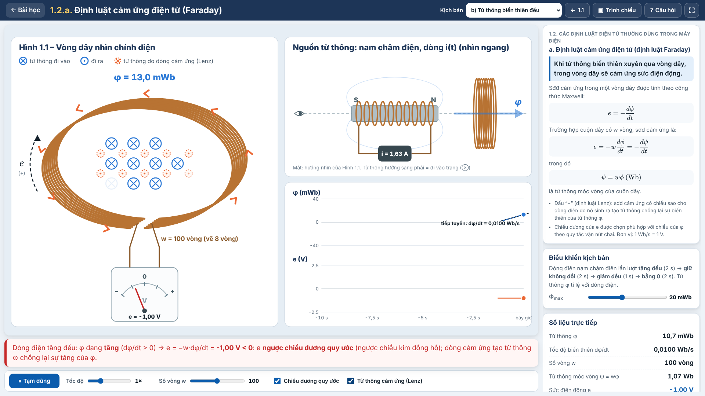
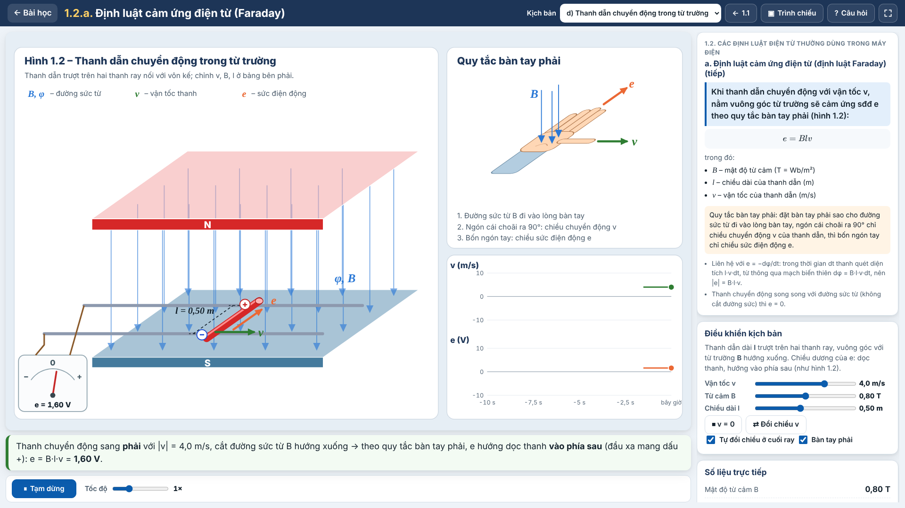
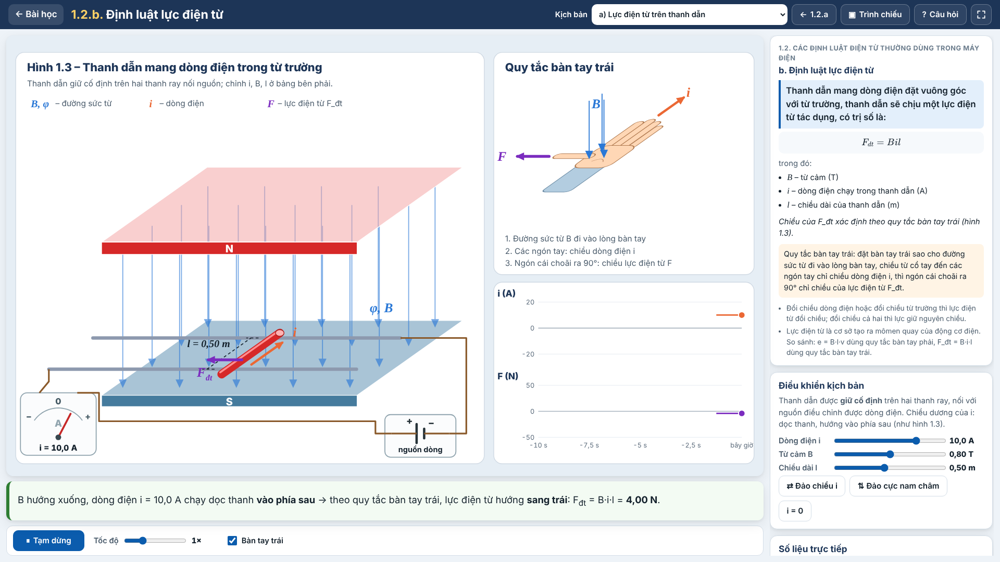
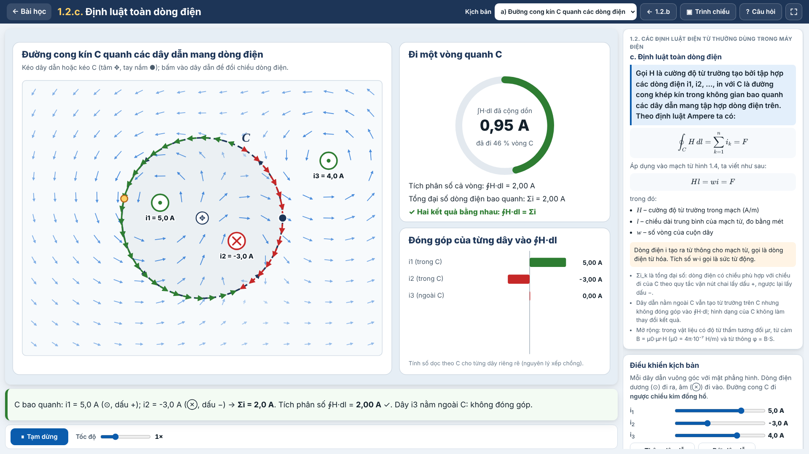

# Mô Phỏng Môn Máy Điện

Website học tập tiếng Việt gồm các mô phỏng tương tác phục vụ môn **Máy điện** cho sinh viên đại học.
Viết bằng HTML/CSS/JavaScript thuần (không cần cài đặt, không cần build), chạy trên **GitHub Pages**,
hiển thị tốt trên **máy chiếu 16:9** và trên **điện thoại**. Toàn bộ hình minh họa tự vẽ bằng SVG.



## Bài 1.1 – Hệ thống năng lượng điện (`he-thong-dien.html`)

Sơ đồ đi từ nguồn đến tải, đánh nhãn A–F:

| Ký hiệu | Bộ phận |
|---|---|
| A | Nguồn phát – nhà máy điện (tháp làm mát, ống khói, tuabin, máy phát) |
| – | MBA truyền tải (MBA tăng áp tại nhà máy) |
| B | Đường dây truyền tải: cột thép cao áp nhiều mạch (500 kV) và lưới 220/110 kV |
| – | TBA truyền tải (giảm áp), TBA phân phối |
| D | Đường dây phân phối trung áp và hạ áp |
| E | Thiết bị tự động phân phối trên cột: recloser (R), cầu dao phụ tải (LBS) |
| C | Khu vực tiêu thụ: nhà máy công nghiệp, tòa nhà cao tầng (có MBA riêng) |
| F | Hộ tiêu thụ: nhà dân, nhận điện qua MBA treo cột |

**Hoạt hình:** hạt sáng chạy dọc đường dây (mật độ và tốc độ tỉ lệ với công suất), tuabin quay, khói/hơi nước,
MBA có vòng sóng "đang hoạt động", đèn cửa sổ sáng/tắt theo tải, bầu trời ngày/đêm. Có nút Chạy/Tạm dừng và chỉnh tốc độ.

**Tương tác:** rê chuột/chạm vào bộ phận để xem tên và cấp điện áp; bấm để mở bảng thông tin (chức năng, cấp điện áp,
thiết bị chính, ghi chú thực tế, số liệu hiện tại). Thanh **Thời gian trong ngày** (0–24 h) thay đổi phụ tải theo đồ thị
phụ tải ngày (vẽ ở góc sơ đồ, bấm vào đồ thị để chọn giờ). Bảng **Số liệu trực tiếp**: công suất phát, dòng điện, tổn thất
và hiệu suất đường dây truyền tải, tổn thất phân phối, công suất tiêu thụ từng khu vực.

**Kịch bản:**

1. **Vận hành bình thường.**
2. **Vì sao phải truyền tải điện áp cao?** Cùng công suất P, chọn U = 22/110/220/500 kV; tính
   `I = P/(√3·U·cosφ)`, `ΔP = 3·I²·R` (hiển thị bằng KaTeX). Độ dày dây thể hiện dòng điện, màu dây đỏ dần theo % tổn thất.
3. **Sự cố ngắn mạch lưới phân phối.** Bấm vào một đoạn đường dây trung áp → tia lửa → recloser cắt → tự đóng lại →
   nếu sự cố duy trì thì LBS cô lập đoạn sự cố, khu vực phía sau mất điện (tắt đèn), các khu vực khác vẫn có điện.
   Có lựa chọn "sự cố thoáng qua" và chú thích từng bước.
4. **Tăng phụ tải đột ngột.** Nhà máy công nghiệp khởi động thêm 60 MW: thấy công suất tuabin tăng theo,
   tần số giảm rồi được khôi phục (mô hình rút gọn, minh họa định tính).

**Giảng dạy:** chế độ **Trình chiếu** (nút Tiếp/Lùi, phím ← →, PageUp/PageDown của bút trình chiếu, Space; Esc để thoát)
đi lần lượt A → F, làm nổi bật bộ phận đang giảng và hiện lời giảng ngắn; nút **Toàn màn hình**;
**Câu hỏi kiểm tra nhanh** 5 câu trắc nghiệm, chấm điểm và giải thích đáp án.



## Bài 1.2.a – Định luật cảm ứng điện từ (`cam-ung-dien-tu.html`)

Thuộc mục 1.2 "Các định luật điện từ thường dùng trong máy điện". Nội dung bám theo slide:

- Từ thông biến thiên xuyên qua vòng dây sinh ra sức điện động cảm ứng.
- Một vòng dây: `e = −dφ/dt`.
- Cuộn dây w vòng: `e = −w·dφ/dt = −dψ/dt`, với `ψ = wφ` (Wb) là từ thông móc vòng.



**Sân khấu mô phỏng:**

- **Hình 1.1:** vòng dây nhìn chính diện, ký hiệu từ thông ⊗/⊙ với mật độ theo |φ|. Có mũi tên chiều dương quy ước của e (quy tắc vặn nút chai), mũi tên chiều thực của e và vôn kế kim giữa.
- **Nguồn tạo từ thông nhìn ngang.**
- **Đồ thị φ(t) và e(t):** trên φ(t) vẽ tiếp tuyến tại thời điểm hiện tại để thấy e tỉ lệ với −dφ/dt.

**Kịch bản:**

- a) **Nam châm chuyển động:** kéo thả nam châm, hoặc bật chế độ tự động; có nút đảo cực.
- b) **Từ thông biến thiên đều** theo dạng hình thang, cho thấy φ không đổi thì e = 0.
- c) **Từ thông hình sin** (nam châm quay như máy phát): `Em = 2π·f·w·Φm`, `E = 4,44·f·w·Φm`.
- d) **Thanh dẫn chuyển động trong từ trường** (slide 3/6, Hình 1.2): `e = B·l·v`, chiều e theo **quy tắc bàn tay phải**.
  - Thanh dẫn trượt trên hai thanh ray nối vôn kế; chỉnh được v (có dấu), B, l; tự đổi chiều ở cuối ray.
  - Hình bàn tay phải xoay theo chiều chuyển động; đồ thị v(t), e(t).



**Tùy chọn và tiện ích:**

- Thanh trượt số vòng w.
- Hiện/ẩn chiều dương quy ước; hiện từ thông của dòng cảm ứng (định luật Lenz).
- Trình chiếu 9 bước, câu hỏi kiểm tra nhanh (ngân hàng 13 câu, mỗi lần 5 câu).

Prompt dùng để xây dựng bài này lưu trong [`docs/prompts/1.2a-dinh-luat-faraday.md`](docs/prompts/1.2a-dinh-luat-faraday.md).

## Bài 1.2.b – Định luật lực điện từ (`luc-dien-tu.html`)

Theo slide 4/6:

- Thanh dẫn mang dòng điện đặt vuông góc với từ trường chịu lực điện từ `F_đt = B·i·l`, trong đó B là từ cảm (T), i là dòng điện (A), l là chiều dài thanh dẫn (m).
- Chiều của lực xác định theo **quy tắc bàn tay trái** (Hình 1.3).



**Kịch bản:**

- a) **Lực điện từ trên thanh dẫn:** thanh giữ cố định trên ray; chỉnh i (có dấu), B, l. Nút "Đảo chiều i" và "Đảo cực nam châm": đổi chiều một đại lượng thì lực đổi chiều, đổi cả hai thì lực giữ nguyên chiều.
- b) **Thanh dẫn chuyển động – nguyên lý động cơ:**
  - Lực điện từ đẩy thanh chạy trên ray.
  - Sđđ cảm ứng e = B·l·v ngược chiều nguồn làm dòng điện `i = (U − e)/R` và lực giảm dần, đến khi B·l·v = U thì thanh chuyển động đều (bỏ qua ma sát).

**Tiện ích khác:**

- Hình bàn tay trái tự xoay hoặc úp theo chiều i và B.
- Đồ thị theo thời gian; trình chiếu 6 bước; ngân hàng 8 câu hỏi.
- Prompt lưu trong [`docs/prompts/1.2b-dinh-luat-luc-dien-tu.md`](docs/prompts/1.2b-dinh-luat-luc-dien-tu.md).

## Bài 1.2.c – Định luật toàn dòng điện (`toan-dong-dien.html`)

Theo slide 10 (`Chuong1-MBA.pdf`):

- Định luật Ampere: `∮_C H·dl = Σi_k = F`, C là đường cong khép kín bao quanh các dây dẫn mang dòng điện.
- Áp dụng cho mạch từ hình 1.4: `H·l = w·i = F`; i là dòng điện từ hóa, w·i là sức từ động.



**Kịch bản:**

- a) **Đường cong kín C quanh các dòng điện:**
  - Kéo thả dây dẫn và đường cong C (tròn hoặc chữ nhật), bấm vào dây để đổi chiều dòng điện.
  - Chấm sáng chạy quanh C cộng dồn ∫H·dl; hết một vòng, kết quả tích phân số bằng tổng đại số Σi.
  - Biểu đồ cho thấy dây nằm ngoài C đóng góp 0.
- b) **Mạch từ có cuộn dây w vòng (hình 1.4):**
  - Mặt cắt cho thấy C bao w thanh dẫn cùng chiều nên Σi = w·i.
  - Chỉnh w, i, l; xem F = w·i, H = w·i/l.
  - Phần mở rộng: B = μ0·μr·H, φ = B·S (μr minh họa, giả thiết tuyến tính).

**Tiện ích khác:**

- Trình chiếu 7 bước; ngân hàng 9 câu hỏi.
- Hàm tính toán trong `js/mach-tu.js`, có test.
- Prompt lưu trong [`docs/prompts/1.2c-dinh-luat-toan-dong-dien.md`](docs/prompts/1.2c-dinh-luat-toan-dong-dien.md).
- Lộ trình xây dựng toàn bộ chương 1 theo slide: [`docs/lo-trinh-chuong-1.md`](docs/lo-trinh-chuong-1.md).

## Lưu ý về số liệu

> Các cấp điện áp, công suất phụ tải, đồ thị phụ tải ngày, thông số đường dây… trong `du-lieu/cau-hinh.json`
> là **giá trị minh họa** phục vụ giảng dạy, không phải số liệu vận hành của một hệ thống cụ thể.
> Giảng viên tự điều chỉnh cho phù hợp với bài giảng.

Giá trị mặc định: điện áp phát 10,5–22 kV; truyền tải 500/220/110 kV; phân phối trung áp 22/35 kV; hạ áp 0,4/0,23 kV.

## Cấu trúc thư mục

```
index.html              Trang chủ: danh sách bài học (đọc từ du-lieu/bai-hoc.json)
he-thong-dien.html      Bài 1.1
cam-ung-dien-tu.html    Bài 1.2.a
luc-dien-tu.html        Bài 1.2.b
toan-dong-dien.html     Bài 1.2.c
css/                    chung.css, mo-phong.css (bố cục chung các trang mô phỏng), trang-chu.css,
                        he-thong-dien.css, cam-ung-dien-tu.css, luc-dien-tu.css, toan-dong-dien.css
js/
  tinh-toan.js          Hàm tính toán thuần (dòng điện, tổn thất, hiệu suất, phụ tải, tần số) – dùng chung cho trang và test
  so-do.js              Vẽ sơ đồ SVG
  hoat-hinh.js          Hạt công suất, khói, MBA, đèn, bầu trời, tia lửa
  do-thi.js             Đồ thị phụ tải ngày và đồ thị theo thời gian
  kich-ban.js           4 kịch bản mô phỏng
  trinh-chieu.js        Chế độ trình chiếu
  kiem-tra.js           Câu hỏi kiểm tra nhanh
  he-thong-dien.js      Khởi động trang, vòng lặp mô phỏng, tương tác
  dien-tu.js            Hàm tính toán bài 1.2.a (e = −w·dφ/dt, ψ = wφ, từ thông hình thang/hình sin/nam châm)
  hinh-dien-tu.js       Vẽ sân khấu SVG bài 1.2.a
  cam-ung-dien-tu.js    Logic trang bài 1.2.a
  thanh-dan.js          Kịch bản d bài 1.2.a: Hình 1.2, quy tắc bàn tay phải, e = B·l·v
  hinh-ray.js           Thành phần vẽ dùng chung cho Hình 1.2 và 1.3 (hình chiếu xiên, nam châm, ray, đồng hồ, bàn tay)
  luc-dien-tu.js        Trang bài 1.2.b: Hình 1.3, quy tắc bàn tay trái, F = B·i·l, nguyên lý động cơ
  mach-tu.js            Hàm tính toán bài 1.2.c (H của dây dẫn thẳng, tích phân vòng ∮H·dl, F = w·i, H = w·i/l)
  toan-dong-dien.js     Trang bài 1.2.c: đường cong kín C, mạch từ hình 1.4
  tien-ich.js           Hàm tiện ích dùng chung (nạp JSON, định dạng số, vẽ KaTeX)
  trang-chu.js          Trang chủ
du-lieu/                Nội dung cho giảng viên chỉnh sửa (JSON)
tests/                  Test Node và script chụp màn hình Playwright
docs/anh/               Ảnh minh họa cho README
docs/prompts/           Prompt dùng để xây dựng từng bài
```

## Chỉnh nội dung trong `du-lieu/`

Mở file bằng trình soạn thảo bất kỳ (VS Code, Notepad++ hoặc sửa trực tiếp trên GitHub). Lưu ý cú pháp JSON:
chuỗi đặt trong ngoặc kép `"…"`, các phần tử cách nhau bằng dấu phẩy, **không** có dấu phẩy sau phần tử cuối.
Các khóa bắt đầu bằng `_` (ví dụ `_ghiChu`) chỉ là chú thích, trang không dùng.

| File | Nội dung |
|---|---|
| `cau-hinh.json` | Bài 1.1 – `capDienAp`: tên, chữ hiển thị (`hienThi`), giá trị tính toán (`kV`) và màu từng cấp điện áp (màu đường dây và chú giải). `truyenTai`: chiều dài, điện trở r₀, cosφ của đường dây B. `phuTai`: công suất cực đại và đồ thị phụ tải 24 giờ (hệ số 0…1) của từng khu vực. `kichBanDienAp`, `kichBanSuCo`, `kichBanTangTai`: thông số các kịch bản. `hoatHinh`: mật độ, tốc độ hạt, giờ mặc định. |
| `bo-phan.json` | Bài 1.1 – thông tin từng bộ phận: tên, chức năng, thiết bị chính, ghi chú thực tế, lời giảng cho chế độ trình chiếu. Thứ tự trong mảng `boPhan` là thứ tự trình chiếu. Viết `{{phat}}`, `{{truyenTai}}`, `{{caoAp}}`, `{{trungAp}}`, `{{haAp}}` để tự chèn cấp điện áp lấy từ `cau-hinh.json` (sửa điện áp một chỗ, mọi nơi cập nhật theo). |
| `cau-hoi.json` | Ngân hàng câu hỏi trắc nghiệm bài 1.1. Mỗi lần làm bài lấy ngẫu nhiên `soCauMoiLan` câu. `dapAn` là **số thứ tự của lựa chọn đúng, bắt đầu từ 0**. |
| `cam-ung-dien-tu.json` | Bài 1.2.a: lý thuyết theo slide (`lyThuyet` cho phần vòng dây, `thanhDan.lyThuyet` cho phần thanh dẫn) (công thức viết bằng LaTeX, kèm dạng chữ thường `duPhong`), thông số mặc định của 3 kịch bản, các bước trình chiếu (`trangThai` cho biết kịch bản, số vòng w, tùy chọn hiển thị ở mỗi bước). Trong JSON, mỗi dấu `\` của LaTeX viết thành `\\`. |
| `cau-hoi-cam-ung-dien-tu.json` | Ngân hàng câu hỏi bài 1.2.a, cùng định dạng với `cau-hoi.json`. |
| `luc-dien-tu.json` | Bài 1.2.b: lý thuyết theo slide, thông số kịch bản a (`luc`) và b (`dongCo`: U, R, khối lượng thanh…), các bước trình chiếu. |
| `cau-hoi-luc-dien-tu.json` | Ngân hàng câu hỏi bài 1.2.b. |
| `toan-dong-dien.json` | Bài 1.2.c: lý thuyết theo slide, vị trí và dòng điện các dây dẫn, đường cong C mặc định (kịch bản `ampere`), thông số mạch từ (`machTu`), các bước trình chiếu. |
| `cau-hoi-toan-dong-dien.json` | Ngân hàng câu hỏi bài 1.2.c. |
| `bai-hoc.json` | Danh sách bài trên trang chủ. `trangThai`: `"san-sang"` (có trang) hoặc `"sap-ra-mat"`. Các bài "sắp ra mắt" hiện có là ví dụ, sửa theo đề cương môn học. |

Sau khi sửa, chạy `npm test` (nếu máy có Node.js) để kiểm tra cấu trúc dữ liệu: test sẽ báo nếu thiếu trường,
đáp án nằm ngoài danh sách lựa chọn, đồ thị phụ tải không đủ 24 giờ hoặc dùng biến điện áp không tồn tại.

## Bật GitHub Pages

1. Đưa mã nguồn lên nhánh mặc định (ví dụ `main`) của kho GitHub.
2. Vào **Settings → Pages**.
3. Mục **Build and deployment → Source** chọn **Deploy from a branch**.
4. Chọn nhánh `main`, thư mục `/ (root)` rồi bấm **Save**.
5. Sau 1–2 phút, trang có địa chỉ dạng `https://<tên-tài-khoản>.github.io/mo-phong-may-dien/`.

File `.nojekyll` đã có sẵn để GitHub Pages phục vụ nguyên trạng các file tĩnh.

## Chạy trên máy cá nhân

Trình duyệt không cho đọc file JSON khi mở trực tiếp bằng `file://`, vì vậy cần một máy chủ tĩnh đơn giản:

```bash
python3 -m http.server 8080        # hoặc: npx http-server -p 8080 .
# mở http://localhost:8080
```

Công thức toán dùng thư viện [KaTeX](https://katex.org) tải từ `cdnjs.cloudflare.com`. Khi không có mạng,
trang vẫn chạy bình thường và hiển thị công thức ở dạng chữ thường.

## Kiểm thử

```bash
npm test             # test hàm tính toán (bộ số liệu tính tay) và cấu trúc dữ liệu JSON
npm run screenshot   # (cần Playwright) chụp ảnh 1920×1080 và 390×844 vào anh-chup/,
                     # tự kiểm tra lỗi JavaScript, nhãn sơ đồ đè nhau, trang tràn ngang
```

Ví dụ một bộ số liệu tính tay trong test: P = 50 MW, U = 110 kV, cosφ = 0,9, R = 5 Ω
→ I = 50·10⁶ / (√3·110·10³·0,9) ≈ 291,59 A; ΔP = 3·291,59²·5 ≈ 1,275 MW (2,55 %).
